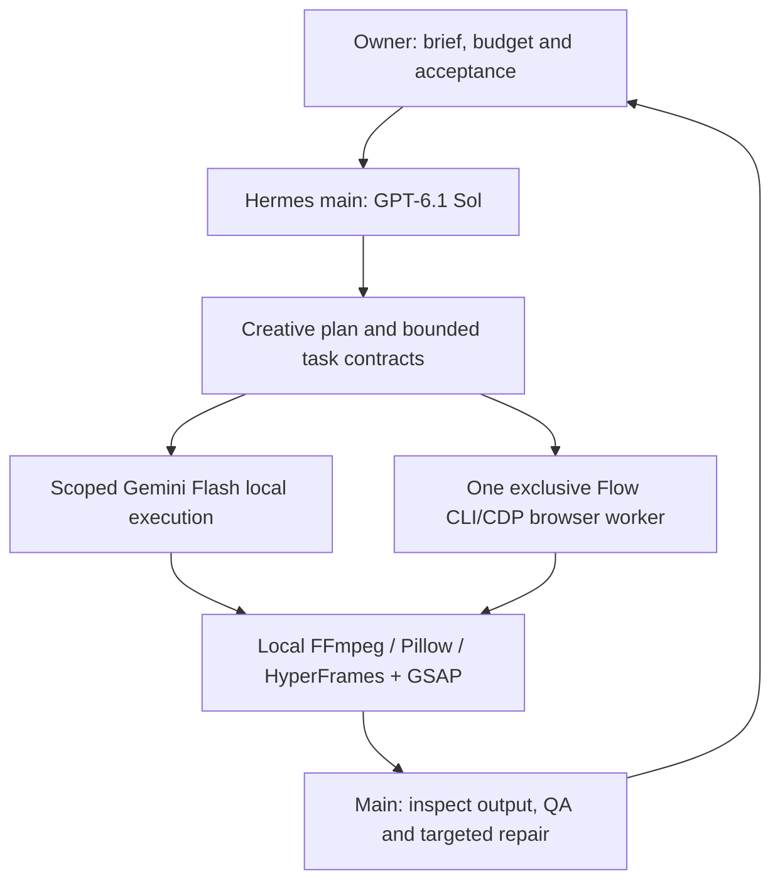

# v-vic — bounded AI commercial-video workflow

Public, sanitized architecture and setup reference · 27 October 2026.
Separate from [VIC’s explainer workflow](../vic-workflow/).

## The work and the role

Three complete 9:16 films accompany this reference: FORGED / Carry the day,
HANDS FULL? / UGC Style A, and ORBIT. Products are fictional; the UGC presenter
is AI-generated, not a customer testimonial. Victor directed the concepts,
AI-assisted implementation, edits and hands-on final review. These exact
films are **not evidence that Hermes produced them autonomously end-to-end**.
No client endorsement, conversion/retention results or real product testing is claimed.

See [media-manifest.json](media-manifest.json) for public file hashes and credits.
The MP4 files are byte-identical to the accepted masters; posters are derived stills.

## Roles and execution

- Main owns research synthesis, story, shot design, timing decisions and final QA.
- Flash receives small execution tasks with explicit inputs, output paths, permitted
  actions, stop conditions and verification. It does not invent the creative plan.
- Up to two genuinely independent local tasks can overlap. One worker exclusively
  owns the Flow browser. Native child browser tools are disabled; this is not a
  swarm of browser agents. The Flow lane is explicitly assigned through CLI/CDP.
- Task checkpoints include exact artifacts, hashes, measured timing and remaining
  work. A stopped task resumes from verified output, not from a claimed success.
- Google Flow generation requires owner-controlled access and approved credit scope.
  LLM usage and Flow credits are distinct; unknown costs are not reported as zero.
- Local editing runs without a generation call. Publishing is a separate owner gate.

## Existing skill integration

The private commercial profile uses `motion-ad` 0.8 and `ugc-ad-video` 0.4.
Both reference the same accepted-edit guide and pinned recipe records.
This public reference describes the setup; it does not distribute the private runtime,
full skills, personal profile, browser data or an installer.

**UGC Style A:** reusable captions on clean 1080 × 1920 / 30 fps picture with
accepted AAC audio already muxed. New reviewed phrase cues drive large normal-width
bold white text, a dark outline, lime emphasis and a controlled spring entry.
The renderer preserves AAC exactly, checks bounds and rejects invalid/overlapping
cues, overwritten outputs and registered already-captioned masters. Phrase animation
does not prove word alignment. Review face/action/product clearance at phone size.

**FORGED:** material hook → loop detail → desk/carry action → moving hero → held CTA.
**ORBIT:** portal → profile morph → matte glint → masked paths → held CTA.
These are bottle-specific recipe references. Adapt footage, claims, brand, copy,
rights and timing for each new product; do not promise one-click reuse. ORBIT's saved
build recipe preceded final layout fixes, so its accepted composition must be inspected
before rebuilding. Do not silently install a replacement renderer.

## Setup checklist

1. Use one isolated Hermes commercial profile and one designated output tree.
   Configure the existing GPT-6.1 Sol main route and Gemini Flash execution lane
   with the owner's accounts; no credentials or provider endpoints are included here.
2. Retain the existing approved Flow browser/profile. The owner signs in. Assign
   exclusive CLI/CDP ownership, bounded credit approval, a single-submit rule and
   download verification. Never bypass login, quotas or provider restrictions.
3. Reuse the existing FFmpeg/Pillow/HyperFrames installation. Check executable
   versions and required font availability before a task; do not create a second
   runtime merely because a worker cannot locate the first one.
4. Pin accepted masters/recipes by hash. Inspect inputs, speech cues and dependencies.
   Start with a representative proof; do not overlay captions on a captioned master.
5. Run technical checks, then review actual picture, sound, continuity and phone layout.
   Record exactly what was checked; pass output to main and owner for acceptance.
6. Publish only the reviewed allowlist. Exclude cookies, tokens, service accounts,
   model caches, private logs, jobs, ledgers, original source media and font binaries.

The caption renderer uses a locally licensed system font. No proprietary font files
are redistributed; another environment needs a properly licensed available font and
fresh text-bound/visual review. This reference grants no license to third-party media.

## Evidence and limits

The accepted-edit integration passed **172 offline tests**, including a synthetic
0.8 s / 24-frame encode, actual readable output, exact AAC/source preservation,
invalid cue/overlap/overwrite rejection and bounded failure cleanup. A separate
CLI render and enabled-skill discovery passed. Source and installed copies matched
for five skill/reference files. This is a dated integration result, not a promise
that this public repository can reproduce those private tests.

A prior Hermes Sol/Flash smoke and a one-clip Flow pilot provide narrower evidence.
No fresh paid generation, new inference run or unattended new-product E2E run was
performed for the preset integration. A desktop-managed environment/lockfile sync
warning remains unresolved. Full media decode and sampled frame/cut review do not
prove continuous listening or eliminate AI lighting/perspective inconsistencies.

## Music and distribution

All three edited films embed “Gimme that Groove!” by Michael Ramir C., Mixkit track872.
[Source](https://mixkit.co/free-stock-music/funk/) ·
[Stock Music Free License](https://mixkit.co/license/modal/musicFree/) ·
[Terms](https://mixkit.co/terms/).
The license was rechecked on 27 October 2026 and allows commercial/non-commercial
web video and online ads. Only complete edited films are supplied: no standalone
track, music-only remix, stock library, rights-management registration or ownership
claim. TV/radio, games and CD/DVD distribution are outside this release's scope.
Upstream software and third-party rights retain their respective terms.
