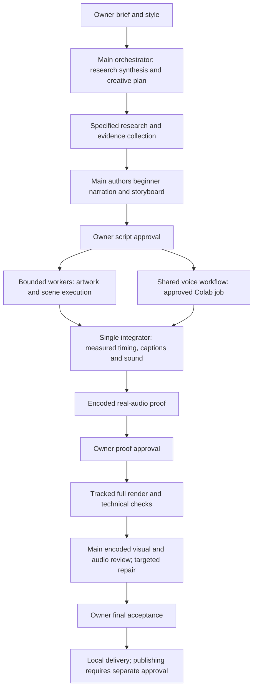

# Architecture and workflow

## Responsibility split

The main model owns audience, useful agent-plus-tool example, source interpretation, hook, narration, storyboard, visual metaphors, pacing, sound decisions and final critique. Gemini Flash executes specific evidence collection or implementation packets. It does not invent missing editorial decisions or certify its own creative output.

Use up to two independent workers only when inputs are fixed and outputs are disjoint. Keep one integrator, one shared browser owner and one renderer per build. Workers do not spawn nested workers. Voice generation and scene work may overlap only when ownership and dependencies permit it.

Each task has exact inputs, writable paths, outputs, acceptance checks and a stop condition. Save input hashes, approvals, stage, process/session handle, outputs and next missing deliverable in the job record. A 100-iteration worker cap is a task execution ceiling, not project quota. Resume missing work from checked artifacts rather than repeating completed generation.

## Quality and sound

Each beat has an entrance, meaningful operation, visible result and appropriate settle/exit. Scene labels summarize key points; captions are a separate display mode. Do not substitute paragraph cards, idle camera motion or mouth movement for explaining a process. Camera depth and presenter size follow the content.

Keep dry narration, music and effects separately. Use topic-appropriate backing, speech ducking and selective event cues; avoid default repetitive bright plucks/bells. Preserve the original voice and measure actual sample timing before synchronizing visuals. Amplitude-driven mouth motion is not phoneme alignment.

Checks cover source binding, facts, timeline coverage, layout/text clearance, encoded format/frame count/decode, narration completeness, transitions, repetition, audio headroom and actual listening coverage. Mechanical PASS is not owner acceptance.
